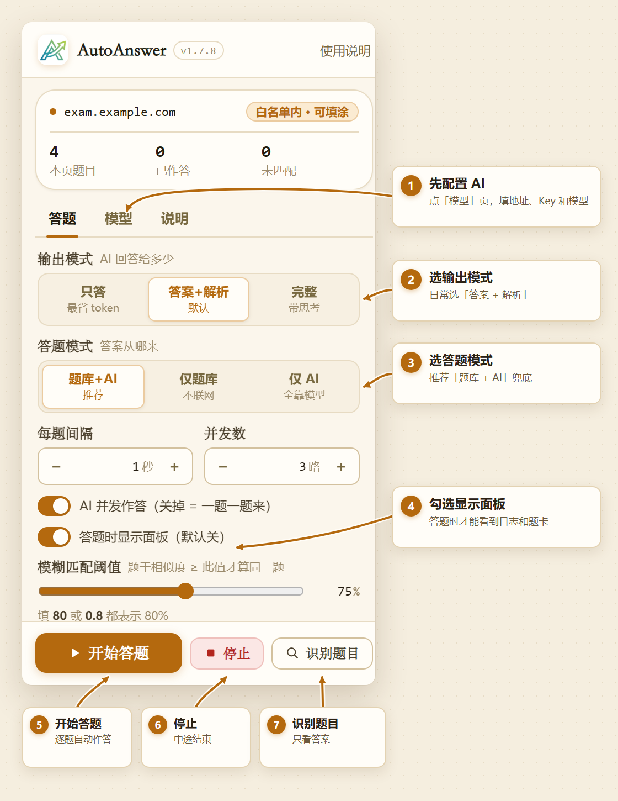

# QuizLens 练习助手

浏览器扩展：在答题网页上识别题目、自动填涂，也可以只显示答案或框选截图解题。

> **插件只填答案，永远不会替你交卷。** 提交/交卷按钮始终由你本人点击。

## ⚠️ 使用边界（请先读这一段）

本插件是**练习 / 自测辅助工具**，不是考试工具。

**判据：只要这一份作答会被打分、被记录、被当作证据，或需要证明是你本人独立完成的，就不要用。无法判断时，视为不允许。**

- 请只在你**有权作答**的页面上使用；
- **正式考试、在线测评、监考环境请勿使用**；
- 因使用本插件导致的任何后果（平台封禁、成绩作废、学校处分等）由使用者自行承担；
- 插件不提供也不会提供自动交卷能力，提交按钮始终由你本人点击。

完整说明（含责任承担、担保排除、题库数据授权切割、再分发建议）见 **[DISCLAIMER.md](DISCLAIMER.md)**。该文件是**使用说明与建议，不是许可证**：代码授权以 [LICENSE](LICENSE)（MIT）为准，本文件不附加任何条件；插件内也有同一份的可读版本，入口在弹窗「说明」页与首次确认框，或直接打开 `extension/docs/disclaimer.html`。

## 仓库内容

| 路径 | 说明 |
|---|---|
| [`extension/`](extension) | **插件本体**。在浏览器扩展管理页里「加载已解压的扩展程序」选这个目录即可。零依赖，不需要 `npm install` |
| [`extension/BANK.md`](extension/BANK.md) | **题库安装教程**。题库不随仓库分发，看这个文件装 |
| [`extension/docs/`](extension/docs) | 插件内使用说明（含图文教程），弹窗底部可直达 |
| [`quiz-app/`](quiz-app) | **配套练习页**：单文件网页版答题界面（`index.html` + `questions.json`），`start.bat` 一键起本地服务。它同时是 e2e 测试的夹具 |
| [`tools/`](tools) | **构建与测试脚本**，不参与插件运行：`build_bank.py` 等做题库转换，`extension-test/` 是 29 个 Playwright e2e 用例，`shim/` 是 19 个零依赖单测（chrome API 桩），`ceval-import/` 负责 C-Eval 导入 |
| [`docs/`](docs) | 仓库文档：题库来源与许可说明等 |
| [`PRIVACY.md`](PRIVACY.md) | 隐私说明：收集什么、发到哪、怎么删 |
| [`CONTRIBUTING.md`](CONTRIBUTING.md) | 贡献指南：工程约定、测试怎么跑、哪些数据不能提交 |
| [`CHANGELOG.md`](CHANGELOG.md) | 版本变更记录 |
| [`SECURITY.md`](SECURITY.md) | 安全问题的私下报告渠道 |

源代码采用 **MIT** 协议，见 [LICENSE](LICENSE)。
**题库数据的许可按来源分别适用**，见 [题库来源与许可说明](docs/题库来源与许可.md)。

## 能做什么

- **自动答题**：识别页面上的单选、多选、判断题并填涂；填空题、句子改写/改错/翻译会写入输入框。
- **题库 + AI 兜底**：先查内置题库，查不到再问大模型；也可以只用题库或只用 AI。
- **只读识别**：扫描当前网页的题目，把答案显示在面板里，不碰页面。
- **截图解题**：框选屏幕上的题目区域，交给视觉模型看图作答。
- **逐题面板**：可查看答案、解析和思考过程；支持暂停、继续、停止。
- **阅读材料**：阅读理解/完形填空会把共享材料一起送给模型。
- 适配问卷星、学习通/超星（新版随堂练习与旧版作业）以及常见表单式答题页。

## 安装

1. 用 Chrome 或 Edge 打开扩展管理页：`chrome://extensions`（Edge 为 `edge://extensions`）。
2. 打开右上角的「开发者模式」。
3. 点「加载已解压的扩展程序」，选择本项目的 `extension/` 目录。
4. 更新插件后，在扩展管理页点「重新加载」；已经打开的答题页请刷新一次。

首次使用会在你点「开始答题」时弹一次「使用边界」确认，勾选后即放行，之后不再打扰。完整说明入口在弹窗底部，随时可以再看。

> **分发方式**：本项目只以「开发者模式 → 加载已解压的扩展程序」方式分发，不上架浏览器应用商店。
> 插件需要 `<all_urls>` 主机权限才能在任意答题页工作，这一权限面在商店审核中会被重点审查；
> 同时，解压加载意味着你拿到的是可自行逐行核对的源码，而不是一个签名过的黑盒——这是使用本插件的前提之一。

## 快速开始

1. 打开要作答的网页。
2. 点浏览器工具栏上的插件图标。
3. 选择答题模式：
   - **题库 + AI 兜底**（推荐）：先查题库，查不到再问 AI。
   - **题库匹配**：只查题库，不联网。
   - **仅 AI**：所有题目都交给大模型。
4. 如果用 AI，填好 **AI Base URL、模型、API Key**，先点「测试连接」。
5. 点「**开始答题**」。插件会逐题作答，但不会提交。
6. 答完后检查页面，自己点提交。

只想看答案、不想让插件碰页面时，用「**识别页面题目**」。

## 图文教程

下面是插件弹窗的实际界面，图上的编号就是操作顺序：

1. 先在「**模型**」页填 AI 地址、Key 和模型；只用题库时可以不填。
2. 回「**答题**」页选输出模式和答题模式；想边答边看日志，就勾选「答题时显示面板」。
3. 点「**开始答题**」自动填涂；只想看答案点「**识别题目**」；中途结束点「**停止**」。

AI 配置、视觉模型和识别面板的带箭头截图，见[使用说明的图文教程](extension/docs/user-guide.html#tutorial)。

## 三种答题模式

| 模式 | 行为 | 适合 |
|---|---|---|
| **题库 + AI 兜底**（默认） | 先查题库，匹配不到再问 AI | 日常使用 |
| **题库匹配** | 只查内置题库，不调用 AI | 确认卷子来自题库、想完全离线 |
| **仅 AI** | 全部题目发给大模型 | 题库里没有的卷子 |

> **题库模式的覆盖率有限。** 内置题库约 11.4 万题、45 个类别，主要覆盖驾考、医学、计算机、考研政治、公务员等；遇到不在库里的卷子会大量「未匹配」，未命中的填空题也无法用题库作答。真实网页上建议用「**题库 + AI 兜底**」。

## 输出模式

控制 AI 回复里给多少内容，只影响 AI 作答，不影响题库命中的题。

| 模式 | 模型返回 | 适合 |
|---|---|---|
| **只输出答案** | 只有答案，没有解析 | 想快、想省用量 |
| **答案 + 解析**（默认） | 第一行答案，后接简短解析 | 日常使用 |
| **完整功能** | 答案 + 逐项详细解析，并开启思考模式 | 难题、需要推理过程 |

自动填涂始终只取答案，解析和思考内容不会写进页面。

## AI 配置

- **AI Base URL**：OpenAI 兼容接口地址，一般以 `/v1` 结尾，例如 `https://api.deepseek.com/v1`。
- **模型**：可手动填写，也可点「拉取模型」从平台获取。
- **API Key**：只保存在本机浏览器里。
- **视觉模型**：截图解题用，必须是支持看图的模型（例如免费的 `glm-4v-flash`）。
- **视觉 Base URL / 视觉 Key**：视觉模型和文本模型不是同一家时填写；同一家留空即可。

填完先点「测试连接」，能连上再开始答题。

## 使用说明

### 开始答题

插件按题目顺序逐题作答并填涂：

- 已经答过的题不会重复问 AI。
- 运行中可以随时「暂停 / 继续」或「停止」；停止会立刻中断正在等待的请求。
- 模型偶尔拒答时，插件会自动重问一次。
- 答完会提示还有多少题没答上，并列出未答题号，方便手动补答。
- **不会自动交卷**，也不会替你点提交。

### 识别页面题目

扫描当前网页的题目，把答案显示在面板里，默认不修改页面。

面板上的「⚡ 出答案」只计算答案；「✍ 填涂」才会点击选项。填涂和「开始答题」受同一份站点白名单限制。

### 截图解题

在识别面板右上角点 📷，框选屏幕上的题目区域，截图会发给视觉模型作答。使用前请先配置视觉模型。

### 暂停与停止

| 按钮 | 行为 |
|---|---|
| **暂停 / 继续** | 停在原地，再点从暂停处接着答，已答过的题不重答 |
| **停止** | 结束本轮，正在等待的请求会立刻中断 |

「开始答题」「出答案」「填涂」三个流程都支持暂停和停止。

### 答题面板

默认不显示面板。勾选「答题时显示面板」后，会在页面上显示同一个面板：

- 上半部分是运行日志，可折叠；
- 下面是识别到的题卡，显示答案、解析和思考过程；
- 面板可拖动、缩放，位置和大小会记住，也可以最小化成悬浮球。

不显示面板时，插件在后台静默运行；弹窗里的「停止」仍然有效。

## 常用设置

| 设置 | 默认值 | 说明 |
|---|---|---|
| **每题间隔** | 1 秒 | 0~30 秒，可填小数；0 最快，但更容易触发接口限流 |
| **AI 并发作答** | 开，3 路 | 可调 1~5；答案仍按题目顺序填涂。接口限流时可调低或关闭 |
| **模糊匹配阈值** | 75 | 50~95；调高更严格、更少误配，调低更容易命中 |
| **题库地址** | 空 | 填了优先使用该地址的题库，任何网页都生效；留空则用插件内置题库，最后尝试网页自带的 `./bank/` |
| **答题时显示面板** | 关 | 开启后在页面上显示日志与题卡面板 |
| **覆盖已选答案** | 关 | 已有选中的题默认跳过；开启后按答案重填：单选覆盖，多选先清掉多余项再补齐 |
| **站点白名单** | 全部站点 | 默认允许所有站点填涂；如需限制，编辑插件目录下的 `whitelist.txt`，一行一个域名，改完重新加载扩展 |

更细的设置说明见 [使用说明](extension/docs/user-guide.html)。

## 支持的页面结构

| 页面结构 | 能识别 | 能自动填 |
|---|---|---|
| 单选/多选/判断（radio、checkbox、可点击选项列表） | ✅ | ✅ |
| 隐藏 input、自绘选项（如问卷星） | ✅ | ✅ |
| 填空输入框、句子改写/改错/翻译 | ✅ | ✅ |
| 选项挤在同一段文字里 | ✅ | ❌（只显示答案） |
| 下拉框、矩阵题、拖拽排序、连线题 | 部分 | ❌ |
| 同源 iframe 内的题目 | ✅ | ✅ |
| 跨域 iframe | ❌ | ❌（需在新标签页打开该框架） |

> 遇到下拉框、矩阵题、拖拽题等暂不支持的题型，可以用「识别页面题目」看答案后手动填写。
>
> 学习通/超星的新版随堂练习与旧版作业/章节测验均已适配；问卷星等第三方站点也可用，但题目由出题人自定义，通常需要走 AI。

## 题库

**本仓库不含题库。** 题库约 **11.4 万题 / 45 个类别 / 29MB**，因各来源授权条款互异（详见 [`DISCLAIMER.md`](DISCLAIMER.md) 第九节），单独打包放在 Releases。

> **题库包已发布**：
> - 主包 `quizlens-bank-v1.zip`（8.2 MB，45 类 / 113,878 题）
> - 补充包 `quizlens-bank-ceval-v1.zip`（0.76 MB，25 学科 / 6,856 题，大学与高中课程）
>
> ⚠️ **题库数据不适用 MIT 许可。** 上游授权已逐条核实，约六成题目没有明确的可再分发授权——包内 `LICENSE-DATA.md` 有逐类的来源/许可/可否再分发清单，**二次分发或商用前请先读它**。只想自己答题的话，装上就能用。

想用「题库匹配」或「题库 + AI 兜底」，先装一次题库，两条路：

| 方法 | 做法 | 适合 |
|---|---|---|
| **① 解压回插件目录**（推荐） | 下载题库包 → 解压得到 `bank/` → 整个放进 `extension/` → 到扩展管理页点「重新加载」 | 大多数人，零配置 |
| **② 填「题库地址」** | 把 `bank/` 用任意静态服务器托管（`python -m http.server` 等），在弹窗「高级 · 题库地址」填 `http://localhost:8000/bank/` | 想放在别处、或局域网多台机器共用 |

> 不想装题库也可以：**「仅 AI」模式功能完整**，只是每题都要调一次模型。

### 可选包

题库分成多个包，按需下载，直接把各包的 `*.json` 与 `index.json` 放进同一个 `bank/` 即可（编号已错开，不会撞号）：

| 包 | 内容 | 许可 |
|---|---|---|
| `quizlens-bank-v1.zip`（8.2 MB） | 主包 45 类 / 113,878 题（驾考、医学、计算机、考研政治、公务员等） | 按来源分别适用，见 [docs/题库来源与许可.md](docs/题库来源与许可.md) |
| `bank-ceval` | C-Eval **25 学科 / 6,856 题**，补大学与高中课程 | **CC BY-NC-SA 4.0（非商业）**，见包内 `LICENSE-DATA.md` |

两包合并后为 70 类 / 120,734 题，实测在真浏览器中可一次性加载并正确命中。

装好后日志会显示 `大题库：45/45 个类别加载成功（来源：扩展内置题库）`。
**完整图文步骤与排错表见 [`extension/BANK.md`](extension/BANK.md)。**

只用 AI 的话跳过题库即可：弹窗「答题模式」选「仅 AI」，不需要任何题库步骤。

- 首次加载约需 4.5 秒；同一页面内再次答题会复用索引。
- 网页自带 `./bank/` 时也会作为最后一个来源尝试。

题库匹配会同时校验选项文本：页面选项顺序与题库不同时按文本重新定位；答案选项在页面上找不到就判为未匹配，宁可交给 AI，也不硬填错误答案。

## 隐私

使用 AI 模式时，以下内容会发送到**你自己填写的 AI 服务地址**：

- 题干、选项；
- 阅读理解/完形填空的共享材料（最长 6000 字）；
- 截图解题时框选的图片。

不会外发：

- 整页内容、表单里的其他字段、密码框内容；
- 除你填写的 AI 地址以外的任何地方。

API Key 只保存在本机浏览器中。只用题库匹配时完全离线。

## 常见问题

**识别不到题目？**
确认页面已经加载完；跨域 iframe 需要在新标签页打开该框架；部分自绘组件或特殊题型可能不支持，可先用「识别页面题目」确认。

**全部显示「未匹配」？**
多半是这份卷子不在内置题库里，或者题库没有加载成功。改用「题库 + AI 兜底」并填好 API Key；如果日志提示题库读取失败，检查「题库地址」或刷新页面。

**点了「填涂」但页面没变化？**
有些页面需要真实点击才会更新状态，插件已经模拟点击；仍不生效时请手动填写。选项挤在文字里、下拉框、矩阵题等本来就不支持自动填。

**返回「请求超时」或「连接失败」？**
先点「测试连接」检查 Base URL、模型名和 Key；确认 Base URL 一般以 `/v1` 结尾。接口限流时，调低并发或关闭并发。

**截图解题报错？**
视觉模型必须支持看图，并单独填在「视觉模型」一栏；跨厂商时还要填视觉 Base URL / 视觉 Key。

**改了设置要重开吗？**
大多数设置即时生效。修改 `whitelist.txt` 后，需要到扩展管理页点「重新加载」。

## 使用边界

本插件用于个人练习与学习。请只在你有权作答的页面上使用，并遵守所在平台的使用规则。

完整条款见 **[DISCLAIMER.md](DISCLAIMER.md)**。

---

## 已知问题

以下是**已确认存在、当前版本尚未修复**的问题，先列出来，避免使用者踩坑：

| # | 问题 | 影响 | 现状 |
|---|---|---|---|
| 1 | **扩展静态资源对任意网页可读（含题库）** | `manifest.json` 的 `web_accessible_resources` 目前匹配所有 http/https 页面。若知道扩展 ID，页面可据此探测本扩展是否安装，并读取暴露的 `bank/*.json`、`whitelist.txt` 与文档资源。题库是单独分发的数据，不是密钥；主要影响是多余暴露与指纹识别 | 计划改为由后台脚本代理读取题库，并收窄 `web_accessible_resources` 的匹配范围；暂未修复 |
| 2 | **默认放行全部站点** | `extension/whitelist.txt` 末行为 `*`，即任意网页都允许自动填涂；插件另外用「文本启发式」判断是否像题目页，对"长得像题的问卷/评教表"没有硬保证 | 有意保留，需要时自行删掉该行并重载扩展 |
| 3 | **填错后无法撤销 / 重填** | 面板「✍ 填涂」对已填过的题会直接跳过，无法用插件纠正 AI 的错误答案，只能手改 | 未实现 |
| 4 | **没有「清除全部本地数据」入口** | API Key 等配置只能手动到开发者工具里删 | 未实现 |
| 5 | **跨域 iframe 不支持** | 题目在跨域 iframe 里时需要在新标签页单独打开该框架 | 设计如此 |
| 6 | **部分题型不支持自动填涂** | 下拉框、矩阵题、拖拽排序、连线题只能看答案不能填 | 设计如此 |
| 7 | **AI 作答无置信度标记** | AI 给的答案与题库命中的答案外观一致，无法一眼区分该核对哪题 | 未实现 |

---

## 许可

- **源代码**：MIT，见 [LICENSE](LICENSE)。
- **题库数据**（`extension/bank/*.json`）：来自多个第三方数据集，**不适用 MIT**，许可按来源分别适用，
  逐条清单见 [题库来源与许可说明](docs/题库来源与许可.md)。
- **图标与界面截图**：`extension/icons/`、`extension/docs/images/` 为本项目原创。
  **名称与图标不随 MIT 代码授权一并授予**——分发修改版请换名称、换图标，不要暗示作者为你的版本背书，见 [DISCLAIMER.md](DISCLAIMER.md) 第十一节。

## 贡献

欢迎提 Issue 和 PR。改动前请注意仓库现有的工程约定：

- **不动已实测的核心逻辑**：`findNextPageButton`（绝不点提交）、`extractAnswerLetters`（解析里的字母不当答案）、
  `remapAnswer`（选项乱序重定位）、空题干硬闸门——这些有实测背书，改了容易出回归。
- **每一处"写页面"后面必须有一次"读回来"**：写完回读 `checked` / `value`，读不回来就如实计入未答。
- **改动必须能被用户看见**：只写进 console 的修复 = 没修。
- 改完请跑一遍冒烟测试：`node tools/extension-test/run-all.js`（需 playwright，安装与排错见 [CONTRIBUTING.md](CONTRIBUTING.md)）。
- **不要提交题库数据**：`extension/bank/`、`quiz-app/bank/`、`tools/bank-src/`、`tools/ceval-import/raw/` 均已加入 `.gitignore`，原因见 [题库来源与许可说明](docs/题库来源与许可.md)。

## 致谢

题库内容来自公开可获取的第三方数据集，来源见 [题库来源与许可说明](docs/题库来源与许可.md)。
感谢各数据集的整理者。
